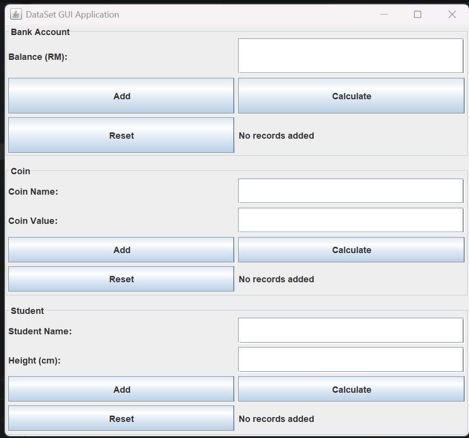

# DataSet GUI Application

## Project Description

This project demonstrates the implementation of a
Graphical User Interface (GUI) using Java Swing.

The application uses Object-Oriented Programming (OOP)
concepts, including interfaces, classes, objects,
and event handling.

## Features

### 1. Bank Account
- Add bank account balances
- Calculate average balance
- Display highest balance and account number

### 2. Coin
- Add coin names and values
- Calculate average coin value
- Display highest coin value and coin name

### 3. Student
- Add student names and heights
- Calculate average student height
- Display tallest student and height

## Java Concepts Used

- Interface (Measurable)
- Classes and Objects
- JFrame and JPanel
- JLabel and JTextField
- JButton
- GridLayout
- ActionListener and ActionEvent
- Event Handling using actionPerformed()

## GUI Screenshot

## How to Run

1. Download the repository.
2. Open the project folder in VS Code.
3. Compile the Java files:

   javac DataSetApp.java DataSetGUI.java

4. Run the GUI application:

   java DataSetGUI

## Project Files

- DataSetApp.java - Original Java application
- DataSetGUI.java - Java Swing GUI implementation
- DataSetGUI.png - GUI screenshot
